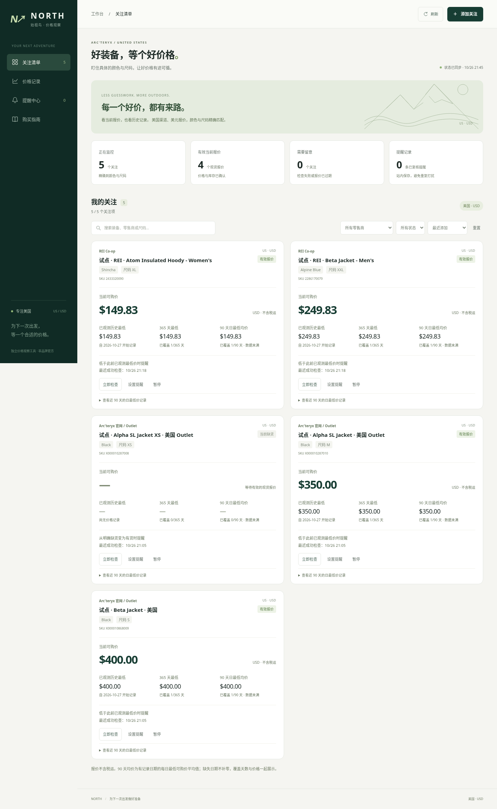

# Arc'teryx 美国价格监控

面向美国的本地监控工作台：粘贴美国官网、美国 Outlet 或 REI 商品链接，读取颜色和尺码，关注目标价、已观测新低或补货。产品范围仅限 **US / USD**。

前端包括关注清单、价格记录、提醒中心和购买指南四个视图。支持名称/颜色/尺码/商家搜索、商家与状态筛选、美元价格排序，以及在页面直接调整目标价、提醒规则和检查间隔。价格记录页另列带原文来源的美国历史促销参考，明确标注是否计入指标。手机端使用紧凑导航与单列卡片。

[查看桌面截图](docs/screenshots/dashboard-desktop.png) · [查看手机截图](docs/screenshots/dashboard-mobile.png) · [历史来源页面](docs/screenshots/history-sources.png)



- [美国购买经验与攻略：附来源](docs/north-america-buying-guide.md)
- [运行、监控规则与实际验证](docs/monitoring.md)
- [Gmail 邮件提醒与电脑定时检查](docs/email-alerts.md)
- [Gamma MX / Sidewinder：男款 XL、XXL 的可导入关注与来源](docs/gamma-mx-sidewinder.md)
- [价格数据库和三项历史指标](docs/database.md)
- [首轮工具调研](docs/research.md)
- [五个成熟开源项目的源码比较与采集优化](docs/open-source-monitoring-review.md)
- [优化后的真实采集验证：5 个关注、4 次页面读取](research/resilience-live-validation.json)
- [真实采集验证记录](research/live-monitor-validation.json)
- [当前美国范围验证：5 个关注、12 条历史参考](research/us-scope-validation.json)
- [第三方零售商与历史资料：接入范围和回填条件](docs/retailers-and-history.md)
- [历史促销来源核查](docs/history-source-research.md)

## 快速开始

Python 3.10+，仅使用标准库，无需安装第三方 Python 包。在仓库根目录运行：

```bash
python3 scripts/run-monitor.py --db data/prices.sqlite3 init
python3 scripts/run-monitor.py --db data/prices.sqlite3 serve --no-worker --port 8080
```

Windows PowerShell 中把 `python3` 换成 `py -3 -X utf8`。`scripts/run-monitor.py` 自动加载仓库程序，日常命令无需设置 `PYTHONPATH`。

服务绑定本机 `127.0.0.1:8080`。在网页中粘贴美国商品链接，读取变体后选择颜色和尺码，再填写目标价；网页按美元填写，例如 **USD 200 输入 `200`**，不需要自己查 SKU 或编写 JSON。每个关注默认每 60 分钟检查，可在“检查频率”中选择每 15 分钟。示例关注不会自动加入新数据库，实际款式与尺码由你选择。

`--no-worker` 让网页负责管理关注，检查交给单次命令或系统定时任务。保存关注后，在另一个终端运行下面的试运行命令，无需先配置 Gmail：

```bash
python3 scripts/run-monitor.py --db data/prices.sqlite3 run-once --dry-run
```

要直接关注男款 Gamma MX（无帽及连帽）和 Sidewinder 的 XL / XXL，可先执行 `watch-import examples/watches.gamma-mx-sidewinder.us.json`。这份[来源已核实的清单](docs/gamma-mx-sidewinder.md)含 20 个具体颜色尺码，设为每 15 分钟、已观测新低提醒；只导入配置，价格从你的首次真实采集开始记录。

**试运行会真实抓取页面并保存价格、检查及站内提醒，只预览邮件而不发送。** 它不是数据库只读模式；返回结果中的 `collection_persisted: true` 会标明采集已保存。尚未添加启用的关注时会明确提示，不会假装正在盯价。

正式邮件发送及定时设置见下节。去掉 `--no-worker` 的网页服务也可持续运行检查调度器，但不会自行发邮件。自己的电脑关机、休眠或断网期间不会正常监控。

临时网络故障会逐步延长重试间隔；商家限流时保存其等待截止时间，重启后继续遵守。来源被拦时先暂停同一主机 1 小时，持续拦截逐步延长至最多 24 小时；正式 Gmail 运行首次被拦即可发送一封来源故障通知。立即检查和读取变体也遵守等待要求。同一轮中，同一商品页的不同尺码共用初次页面读取，提醒复核仍独立重新请求。运行汇总分别显示变体检查数与 `page_fetches` 页面读取数，并明确指出是否所有来源都被拦。

工作台包含美国关注清单、价格历史、覆盖天数及站内提醒。提醒经两次读取确认并去重。配置 Gmail 后，`run-once --notify gmail` 可发送邮件并记录发送结果；网页服务本身仍只生成站内提醒。本版为单用户本地工具，不支持直接开放到公网。

## 单次检查并发邮件

先按 [邮件设置](docs/email-alerts.md) 配置 Gmail 应用专用密码，可用 `gmail-test --env-file /absolute/private/gmail.env` 主动发送一封配置测试邮件，再运行：

```bash
python3 scripts/run-monitor.py --db data/prices.sqlite3 run-once --notify gmail --env-file /absolute/private/gmail.env
```

默认检查所有已到期的美国关注，并发送尚未送达的有效提醒。`--force` 检查全部启用的关注，仍遵守商家等待；系统定时任务不要加这个参数。来源拦截立即生成来源级故障通知，其他采集故障连续三次失败后提醒；发送失败会在后续运行中重试。

要更快发现降价，把关注的检查间隔设为 **15 分钟**，再让系统每 **5 分钟**调用一次 `run-once`；每次调用只检查已到期商品。Linux 可使用独立的 [cron 模板](examples/schedulers/arcteryx.cron)，Windows 和 macOS 的配置见[定时任务说明](docs/email-alerts.md#4-让电脑每-5-分钟调用一次)。降低间隔不会绕过商家限流或已有等待期限。

## 已验证与限制

已真实验证美国官网、美国 Outlet 和 REI 的明确变体。当前工作库启用 20 个男款 Gamma MX / Sidewinder 的 XL、XXL 关注，每 15 分钟检查；[首轮真实检查](research/gamma-mx-sidewinder-live-validation.json)全部成功，5 个页面共用初次读取。此前 5 个美国试点已暂停，已有记录保留。旧版建立的 1 个加拿大关注继续停用并从产品界面隐藏。

当前启用的关注都来自已核实的 REI 页面，官网与 Outlet 的对应款式仍待核实。已将 12 条 2025—2026 年的真实美国历史促销报道导入工作库的独立参考表，也可用下方命令在新库重建。报道的原帖日期、价格、条件和来源均保留，但不冒充零售商已核验的具体尺码库存。[此前入库与监控验证](research/retailer-history-live-validation.json) 保留当时的完整快照，历史文件中的加拿大记录不表示当前支持范围。

指标记录从实际采集开始，没有补造历史。365 天最低价、90 天每日最低价均值会同时显示实际覆盖天数。历史报道未通过精确变体存档核验，不计入这些指标；本次尚未取得合格的旧变体存档。未来价格、库存和页面结构可能变化，具体快照见验证记录。

关注记录按 URL 和 SKU 独立保存，当前看板不会自动将官网、Outlet、不同语言页面或不同代产品合并。数据库的底层指标支持明确映射后的跨店比较，但自动商品匹配尚未实现。

## 命令行

```bash
# 发现真实页面中的明确变体
python3 scripts/run-monitor.py discover https://arcteryx.com/us/en/shop/mens/beta-jacket-0868
python3 scripts/run-monitor.py discover https://www.rei.com/product/228617/arcteryx-beta-jacket-mens

# 添加一个示例真实商品关注（之后检查时读取价格；重复关注会被拒绝）
python3 scripts/run-monitor.py --db data/prices.sqlite3 watch-add examples/watch.us.json

# 批量添加实际款式；重复导入保留已有设置，不导入价格。
python3 scripts/run-monitor.py --db data/prices.sqlite3 watch-import examples/watches.gamma-mx-sidewinder.us.json

python3 scripts/run-monitor.py --db data/prices.sqlite3 watch-list
# 将自己的关注 1 改为每 15 分钟检查；先用 watch-list 确认编号。
python3 scripts/run-monitor.py --db data/prices.sqlite3 watch-update 1 examples/watch.interval-15.json
python3 scripts/run-monitor.py --db data/prices.sqlite3 check --watch-id 1
python3 scripts/run-monitor.py --db data/prices.sqlite3 alerts

# 导入实际取得的历史促销参考（幂等；不增加指标观测）
python3 scripts/run-monitor.py --db data/prices.sqlite3 history-import research/historical-price-evidence.json
python3 scripts/run-monitor.py --db data/prices.sqlite3 history-list
PYTHONPATH=src python3 -m unittest discover -s tests -v
```

`data/prices.sqlite3` 保存在本地并被 Git 忽略。表结构、程序、研究和验证记录纳入版本管理。`examples/observations.example.json` 是合成单元测试示例，只能导入独立测试库；`examples/watch.us.json` 是真实商品的关注配置，不包含伪造价格。`examples/watch.interval-15.json` 只调整检查间隔，不创建关注或更换商品。

浏览器回归：`node tests/frontend.e2e.cjs`。测试环境需要可用的 Node.js、Playwright 与 Chromium；当前云环境已提供。该测试使用隔离的合成 API 数据，覆盖实际浏览器操作、移动布局、断线、数据缺口和键盘焦点，不改动工作库。应用本身仍不依赖 Node.js。

[GitHub Actions](.github/workflows/tests.yml) 在 PR 和 main 更新时自动检查 Linux、Windows 上的 Python 3.10/3.12 测试，并运行 Chromium 浏览器回归。测试使用隔离数据库和模拟 HTTP/SMTP，不需要 Gmail 密钥或真实商品降价。
