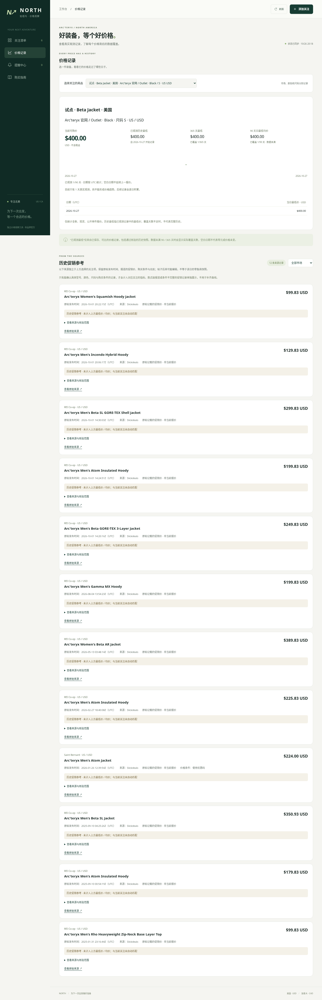

# 第三方零售商与历史资料

本次扩展将 REI 美国站接入实际监控，并把可追溯的旧促销报道保存到独立历史资料表。网页中存在一个旧日期或一个低价，不代表它能作为当前关注的同款同尺码历史价格。

## 当前零售商范围

| 来源 | 地区 / 币种 | 接入状态 |
| --- | --- | --- |
| Arc'teryx 官网 | US / USD、CA / CAD | 保留原有变体采集与监控 |
| Arc'teryx Outlet | US / USD、CA / CAD | 解析器支持；美国实际验证，加拿大仍待验证 |
| REI Co-op | US / USD | 新增真实商品页验证；按 REI 自身的 SKU、颜色和尺码采集 |
| MEC | CA / CAD | 本次请求返回 HTTP 403，尚未接入 |
| Altitude Sports | CA / CAD | 已查询品牌、搜索及旧品牌路径，未取得可验证的 Arc'teryx 变体报价；不能据此推断全站销售或库存状态 |
| Backcountry | US / USD | 本次查询没有取得可验证商品，不作为已接入来源 |
| Valhalla Pure、Monod Sports、Sporting Life 等 | CA / CAD | 当前环境访问受限，未绕过限制，尚未验证 |

具体请求、时间、页面哈希与结果见 [零售商验证记录](../research/third-party-retailers.json)。REI 的商品页可以在工作台直接添加，例如：

```text
https://www.rei.com/product/228617/arcteryx-beta-jacket-mens
```

来源接入要求完整、明确的商品变体数据。价格范围、缺少尺码的父商品报价、会员专享价格、未知库存或非 Arc'teryx 商品不会被当成有效现货报价。来源返回错误时保留历史，并显示检查失败。

2026-10-27 UTC 的工作库验证新增两个 REI 关注：男款 Beta / Alpine Blue / XXL（SKU `2286170079`）当次 USD 249.83，女款 Atom Hoody / Shincha / XL（SKU `2433320090`）当次 USD 149.83，均为现货。试点用于验证，不代表用户已选择这些款式或尺码，也不是价格承诺。当前共有 6 个关注，12 条历史报道已入库，合格的存档回填数为 0；完整结果见 [工作库验证](../research/retailer-history-live-validation.json)。

REI SKU 与官网 SKU 不互换。当前每个 URL + SKU 独立监控，不因标题相似就跨店合并，也不直接比较 USD 和 CAD。已有官网关注的身份和历史保持兼容。

## 两类历史记录

**历史促销参考**保存来自旧促销帖的事实摘要：原帖发布时间、取得时间、报道金额、地区和币种、商家、适用条件、来源地址及页面内容哈希。Slickdeals 员工或社区帖子属于促销报道，不是零售商存档或成交凭证。当前页面可能在最初发布后修改，原帖时间不证明当前正文的所有内容都在当时存在。

这类资料可用于理解过去出现过什么促销，但通常缺少精确 SKU、款式版本或当时的尺码库存。它们单独展示，**不进入关注的历史最低价、365 天最低价或 90 天均价**。优惠码、会员资格和适用颜色等条件会保留，不能当成无条件公开价格。

**可核验的变体存档**才有资格回填价格指标：需要获取有明确时间戳的原零售商页面存档，核对内容哈希、原商品地址、币种、SKU、颜色、尺码、公开新货价格和当时库存。回填过程不修改当前报价，不触发历史提醒。仍缺失的日期继续为空，不补零、不延用前一天的价格。

本次尚未取得能通过这套核验的旧变体存档，不能宣称补齐了 365 天或 90 天历史。Wayback 的访问在当前环境受限。真实取得的历史促销报道见 [资料 JSON](../research/historical-price-evidence.json) 和 [来源核查说明](history-source-research.md)。



## 网络与后续验证

在原有配置基础上，环境草稿增加了 `web.archive.org`、`archive.org`，以及 `vpo.ca`、`monodsports.com`、`sportinglife.ca` 的根域和 `www` 域，并显式补充 `www.rei.com`。草稿保存不等于当前网络已放行；需要在环境设置中审阅、保存并发布，再重试受限来源。域名放行也不保证网站提供足够的变体或历史数据。

不绕过登录、验证码、网络策略或付费 API。当前没有 Keepa API 凭据，未声称取得 Amazon 历史或第三方完整价格曲线。
